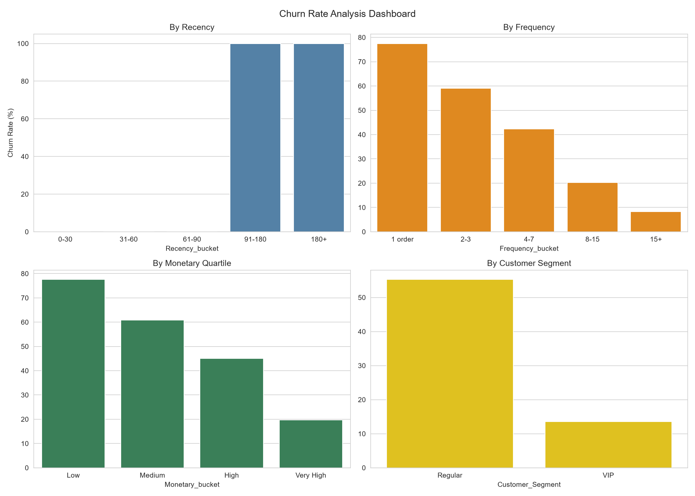
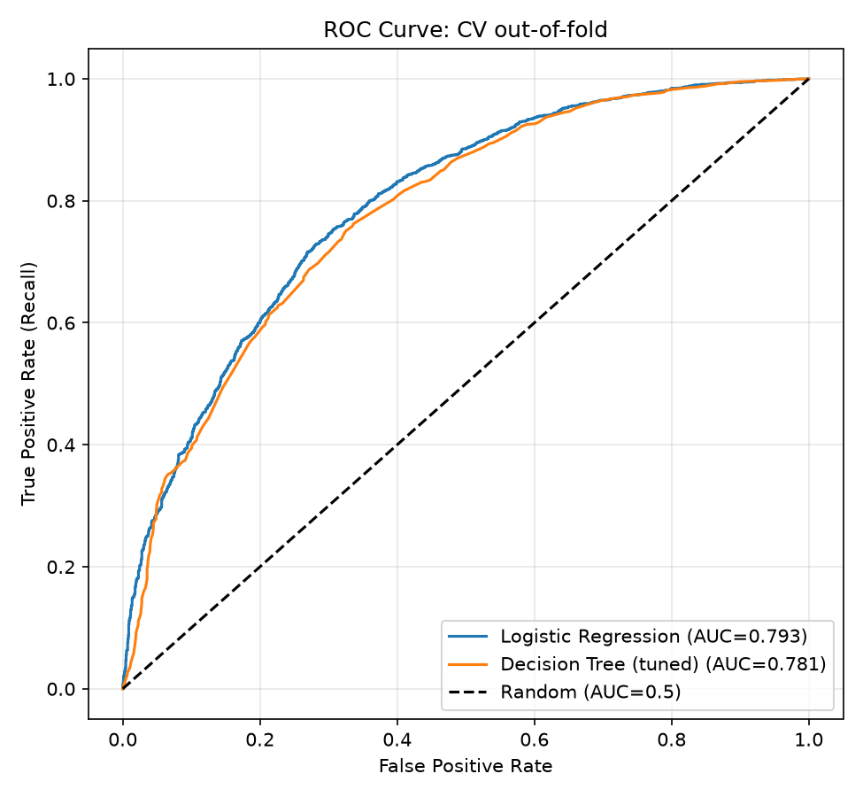
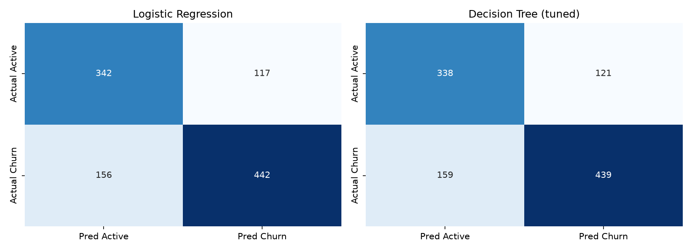

# E-Commerce Customer Churn Prediction

> End-to-end data science project: SQL → Python/Pandas → Statistics & EDA → Machine Learning,
> predicting which customers will stop buying in the next 90 days.


## Table of Contents
- [Business Problem](#business-problem)
- [Dataset](#dataset)
- [Approach](#approach)
- [Key Findings](#key-findings)
- [Model Results](#model-results)
- [Repository Structure](#repository-structure)
- [How to Run](#how-to-run)
- [Limitations](#limitations)
- [Roadmap](#roadmap)
- [Author](#author)

## Business Problem
Acquiring a new customer costs far more than retaining an existing one. This project
identifies customers likely to churn **before** they leave, so a retention team can
target a limited campaign budget at the right people.

**Goal:** rank customers by churn risk and flag the top at-risk group for outreach.

## Dataset
**Online Retail II** (UCI / Kaggle): ~1.07M transactions from a UK-based online retailer,
Dec 2009 – Dec 2011, 8 columns (Invoice, StockCode, Description, Quantity, InvoiceDate,
Price, Customer ID, Country).
The raw data is not stored in this repo, see [`data/README.md`](data/README.md) for download steps.

## Approach

### 1. SQL (Month 1)
Loaded the data into SQLite and analysed it with JOINs, window functions
(`ROW_NUMBER`, `RANK`, `NTILE`, `LAG`), chained CTEs for an RFM-style summary, and indexing
with `EXPLAIN QUERY PLAN`. Key queries are in [`src/sql/`](src/sql/).

### 2. Data Cleaning (Month 2)
| Step | Decision |
|---|---|
| Missing `Customer ID` (~22.8%) | Dropped: guest checkouts can't be tracked per customer |
| Duplicates | Removed |
| Cancellations (Invoice starts with `C`) | Removed: they distort monetary value |
| Non-product codes (POST, DOT, M, ADJUST, ...) | Identified and excluded |
| Missing `Description` | Filled with `'Unknown Product'` (display-only field) |

### 3. Target Variable Definition
A customer is **churned** if they place **no order in the 90 days after a cutoff date**
(cutoff = last date in the data − 90 days).

**Features use only transactions before the cutoff.** The label comes only from the window after it.
This avoids *data leakage*.

### 4. Statistics & EDA (Month 3)
Hypothesis tests (permutation test, Welch t-test, chi-square), effect sizes,
correlation analysis, IQR outlier analysis, and a churn-rate deep dive.
Full report: [`notebooks/month3_statistics_eda/63_eda_report_final.ipynb`](notebooks/month3_statistics_eda/63_eda_report_final.ipynb)

### 5. Machine Learning (Month 4)
- Leakage-free features: Recency, Frequency, log-Monetary, AvgOrderValue, Tenure, UniqueProducts, Region
- Stratified train/test split (80/20); scaling done **inside** pipelines
- Imbalance handled and compared: baseline vs `class_weight='balanced'` vs SMOTE (5-fold CV)
- Models: Logistic Regression and a tuned Decision Tree (validation curves + GridSearchCV)
- Evaluation: confusion matrix, precision/recall/F1, ROC-AUC

## Key Findings
- **Total Customers:** 5,283
- **Churn rate:** 56.6% of customers (imbalance ratio 1.3:1)
- **First-time buyers are the riskiest:** higher churn compared to customers with 4+ orders.
- **Spend is heavily right-skewed:** top customers kept as a VIP segment rather than removed.
- **Geography:** UK vs Rest of World analysis completed using chi-square tests.
- **Recommendation:** a "second purchase" incentive shortly after a first order.



## Model Results
5-fold CV on the training set, followed by a single evaluation on the held-out test set.

| Model | Test Precision | Test Recall | Test F1 | Test ROC-AUC |
|---|---|---|---|---|
| Logistic Regression | 0.791 | 0.739 | 0.764 | 0.809 |[span_10](start_span)[span_10](end_span)
| Decision Tree (tuned) | 0.784 | 0.734 | 0.758 | 0.807 |[span_11](start_span)[span_11](end_span)
| Baseline (majority class) | 0 | 0 | 0 | 0.50 |





> Accuracy is deliberately not the headline metric: with imbalanced classes a model
> that always predicts the majority class gives a false sense of high performance.

## Repository Structure
```text
├── data/                 # not tracked, see data/README.md
├── notebooks/
│   ├── month1_sql/
│   ├── month2_python_pandas/
│   ├── month3_statistics_eda/
│   ├── month4_machine_learning/
│   └── weekly_tests/
├── src/
│   ├── sql/              # reusable SQL queries
│   ├── cleaning/         # data cleaning
│   ├── features/         # leakage-free feature builder
│   └── models/           # evaluation helpers
├── reports/              # charts and comparison tables
└── requirements.txt

## How to Run
```bash
git clone https://github.com/rkkumar945/ecommerce-churn-project.git
cd ecommerce-churn-project
python -m venv venv
source venv/bin/activate        # Windows: venv\Scripts\activate
pip install -r requirements.txt
```
1. Download the dataset to `data/raw/online_retail_II.csv` (see `data/README.md`).
2. Run notebooks in order: `month1_sql` → `month2_python_pandas` → `month3_statistics_eda` → `month4_machine_learning`.
3. Rebuild the ML dataset from the command line: `python -m src.features.build_features`

## Limitations
- Data is from 2009–2011 from a single UK retailer, so patterns may not transfer to other businesses.
- The 90-day churn window is a business assumption; other thresholds would change the churn rate.
- Test set has 1,057 churners, so metric confidence intervals are fairly wide.
- Predicted probabilities are not calibrated (class weighting inflates them); the model is meant for **ranking** customers.

## Roadmap
- [x] SQL, Python/Pandas, statistics, EDA
- [x] Leakage-free ML with CV, imbalance handling and evaluation
- [ ] Random Forest / XGBoost, hyperparameter tuning
- [ ] RFM segments and customer lifetime value
- [ ] SHAP explainability
- [ ] MLflow experiment tracking
- [ ] Streamlit web app + deployment

## Author
**Rajat Kumar**, [LinkedIn](#) · [GitHub](#)