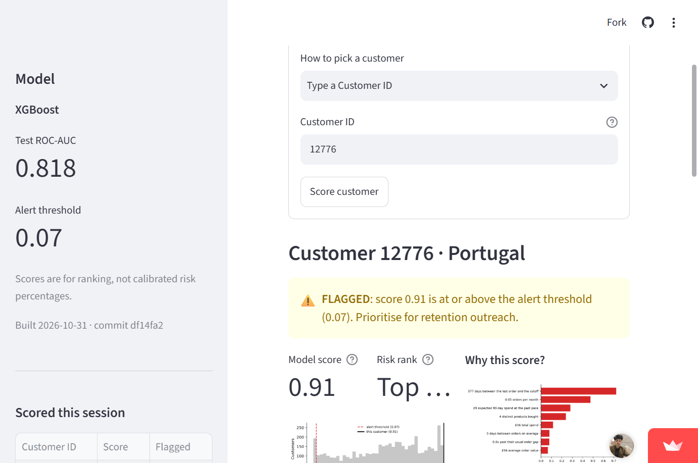
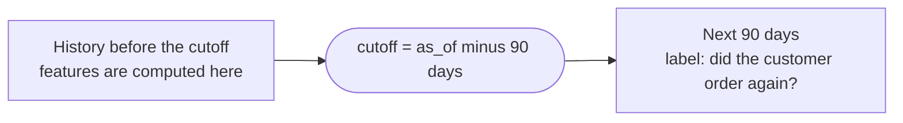
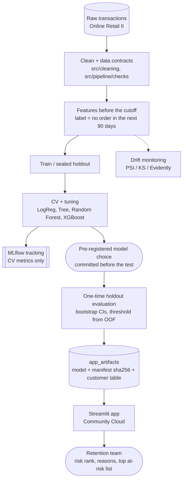
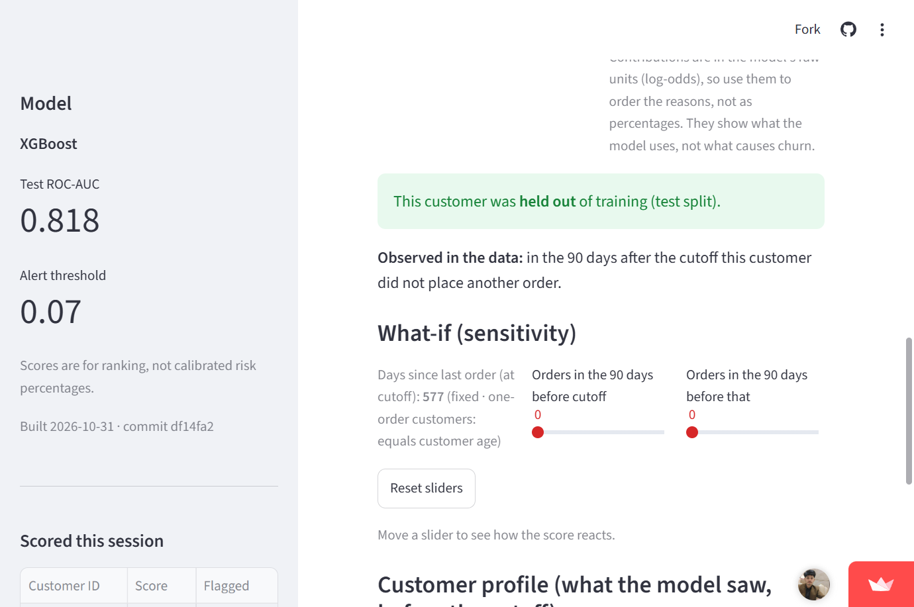
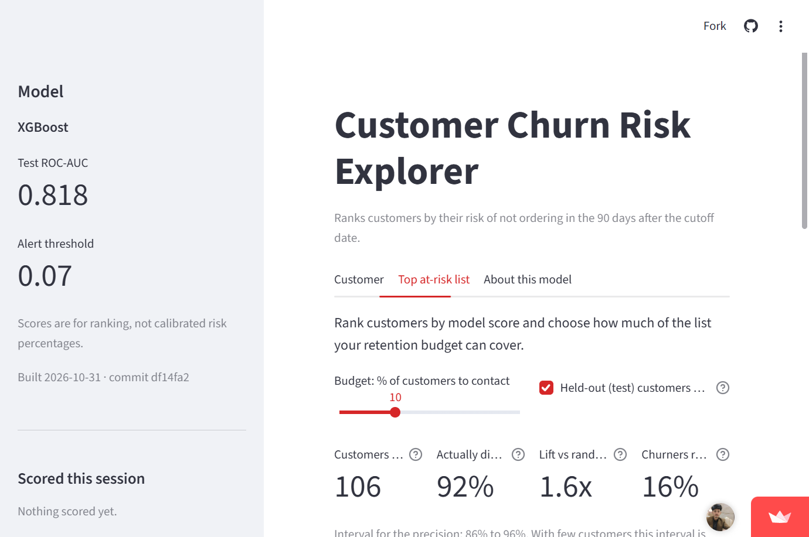
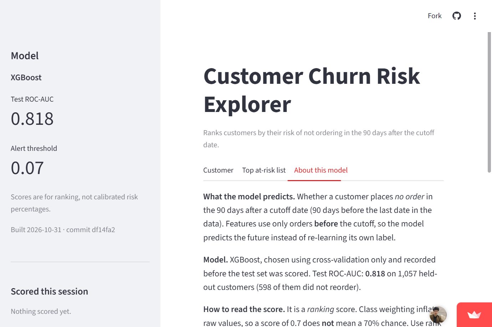

# E-Commerce Customer Churn Prediction

[](https://ecommerce-churn-project.streamlit.app/)

> An end-to-end data science project, from SQL to a deployed web app. It ranks customers by their risk of not
> ordering in the next 90 days, explains each score, and helps a retention team spend a limited budget.

**Live demo:** https://ecommerce-churn-project.streamlit.app/
*(Free hosting: the app sleeps after about 12 hours without visitors. If you see a wake-up page, press the button and wait up to a minute.)*



## Table of Contents
- [Start Here](#start-here)
- [Business Problem](#business-problem)
- [Dataset](#dataset)
- [Approach](#approach)
- [Results](#results)
- [System Architecture](#system-architecture)
- [The App](#the-app)
- [Engineering Practices](#engineering-practices)
- [Repository Structure](#repository-structure)
- [How to Run](#how-to-run)
- [Limitations](#limitations)
- [Roadmap](#roadmap)
- [Author](#author)

## Start Here
1. **Live app:** [ecommerce-churn-project.streamlit.app](https://ecommerce-churn-project.streamlit.app/). Pick a customer from the held-out (test) split for an honest score.
2. **EDA report:** [notebooks/month3_statistics_eda/63_eda_report_final.ipynb](notebooks/month3_statistics_eda/63_eda_report_final.ipynb)
3. **Final evaluation:** [reports/model_comparison_report.md](reports/model_comparison_report.md)
4. **Design notes:** [retraining](docs/retraining_design.md), [monitoring](docs/monitoring_plan.md), [deployment](docs/deployment.md)

The model ranks customers by their risk of not ordering in the 90 days after a cutoff date, using only transactions made before that date. On a sealed held-out set it reaches a test ROC-AUC of 0.818 (95% bootstrap CI 0.791 to 0.843). Contacting the 10% highest-scored held-out customers finds non-returners with 92.5% precision (lift 1.634x, against a 56.6% base rate) and reaches 16.4% of all non-returners.

## Business Problem
Winning a new customer usually costs more than keeping an existing one, and a retention team can only contact so many people.
The useful output is therefore a **ranking**: who is most likely to stop buying, and why.

## Dataset
**Online Retail II** (UCI / Kaggle): 1,067,371 transactions from a UK-based online retailer, Dec 2009 to Dec 2011, 43 countries,
5,942 identified customers. 22.8% of rows have no Customer ID (guest checkouts, dropped) and 19,494 rows are cancellations (removed).
The modelling table contains 5,283 customers: 61 customers whose records contain only cancellations are removed, and 598 more are dropped because they have no purchase before the cutoff date.
The raw data is not stored in this repo, see [data/README.md](data/README.md).

## Approach
| Stage | What was done | Where |
|---|---|---|
| SQL | SQLite, JOINs, window functions, chained CTEs, indexing | `notebooks/month1_sql`, `src/sql` |
| Cleaning | Guest checkouts, cancellations and duplicates removed, typed dates, data contracts | `src/cleaning`, `src/pipeline/checks.py` |
| Target | Forward-looking 90-day label (below) | `src/features/build_features.py` |
| Statistics and EDA | Permutation test, Welch t-test, chi-square, correlation, outliers, churn deep dive | `notebooks/month3_statistics_eda` |
| Baseline ML | Logistic Regression and Decision Tree, stratified split, CV, SMOTE vs class weights | `notebooks/month4_machine_learning` |
| Advanced ML | RFM segments, behavioral features, Random Forest and XGBoost, tuning, nested CV, SHAP | `notebooks/month5_advanced_mlops`, `src/models` |
| MLOps | MLflow tracking, retraining pipeline with a DAG runner, drift monitoring | `src/tracking`, `src/pipeline`, `src/monitoring` |
| App | Streamlit app on Community Cloud | `src/app`, `app_artifacts` |

### Target definition (no leakage)
A customer is **churned** if they place no order in the 90 days after a cutoff date (cutoff = last date in the data minus 90 days).
Features use only transactions **before** the cutoff, so the model predicts the future instead of re-learning its own label.



An earlier version defined churn from Recency over the whole period, which would let a model simply re-learn that rule.
The EDA notebooks (Month 3) still use that descriptive label; the ML models use the forward-looking one, so the two churn rates differ by design.

## Results
Final model chosen on cross-validation only and recorded in [reports/final_model_choice_day84.md](reports/final_model_choice_day84.md)
before the held-out set was scored.

| | |
|---|---|
| Final model | XGBoost (learning_rate 0.03, max_depth 2, n_estimators 150) |
| Customers (train / held-out) | 4,226 / 1,057 (churn rate 56.6%) |
| Test ROC-AUC (95% bootstrap CI) | 0.818 (0.791 to 0.843) |
| Test PR-AUC (base rate) | 0.838 (0.566) |
| Alert threshold | 0.07, chosen on out-of-fold predictions with assumed costs |
| Top 10% targeting | precision 0.925 (95% bootstrap CI 0.858 to 0.962), lift 1.634x, reaches 16.4% of non-returners |

Nested cross-validation (honest estimate after tuning):

| Model | Nested CV ROC-AUC |
|---|---|
| Logistic Regression | 0.796 |
| Decision Tree | 0.778 |
| Random Forest | 0.802 |
| XGBoost | 0.803 |

**Key findings** (forward-looking ML label unless stated)
- Descriptive EDA label (whole-period, Recency-based): customers with one order churn at 77.5%, against 29.4% for customers with 4 or more orders.
- Descriptive EDA label: VIP customers churn at 13.6%, against 55.3% for Regular customers.
- The top SHAP feature group is Frequency / volume (importance 0.474), followed by Recency / timing (0.342), Monetary / value (0.228) and Basket / product (0.181). Tenure (0.014) and Geography (0.002) add almost nothing.
- Nested CV scores for Logistic Regression (0.796), Random Forest (0.802) and XGBoost (0.803) sit within one standard deviation (about 0.014 to 0.016) of each other, so the model choice is not statistically decisive.
- At the chosen threshold of 0.07 the model has recall 0.998 and precision 0.586 against a base rate of 0.566: it flags almost every customer, so the ranking (AUC 0.818) is the useful output, not the alert flag alone.

## System Architecture


## The App
Live at https://ecommerce-churn-project.streamlit.app/

- Score any customer by ID: model score, risk rank, alert flag, and whether the model saw this customer in training.
- SHAP reasons for each score (what pushes it up or down), shown as a chart and plain text.
- What-if sliders with consistency checks (impossible scenarios are rejected). This is sensitivity, not causation.
- Top at-risk list for a chosen budget, with a confidence interval on precision and a CSV download.
- About tab with the build manifest next to the running library versions.

 



## Engineering Practices
| Risk | Guard | Where |
|---|---|---|
| Label leakage | Features before the cutoff only; changing future rows must not change any feature | `tests/test_build_features.py` |
| Peeking at the test set | Model choice committed before the test; tracking accepts CV metrics only | `reports/final_model_choice_day84.md`, `tests/test_tracking.py` |
| Train/serve skew | App scores reproduce the reported test AUC; what-if formulas match training formulas | `tests/test_lookup.py`, `tests/test_whatif.py` |
| Wrong or tampered model | sha256 check and library-version manifest before loading | `tests/test_serialization.py`, `tests/test_deploy_ready.py` |
| Silent bad data | Data contracts, a freshness guard on `as_of`, a sealed holdout in the pipeline | `tests/test_checks.py`, `tests/test_run_pipeline.py` |
| Drift | PSI with an A/A calibration and an alert policy | `tests/test_drift.py` |

100 automated tests, 70+ commits, all analysis reproducible from the notebooks and `src/`.

## Repository Structure
```
├── app_artifacts/        # deployable model, manifest and customer table
├── data/                 # not tracked, see data/README.md
├── docs/                 # architecture, deployment, monitoring, retraining notes, images
├── notebooks/            # month1_sql ... month5_advanced_mlops, weekly_tests
├── reports/              # charts and comparison tables
├── scripts/              # parity check, README facts, image optimizer, Evidently report
├── src/
│   ├── app/              # Streamlit UI, service logic, artifact export (requirements.txt for Cloud)
│   ├── cleaning/ features/ models/ monitoring/ pipeline/ tracking/ sql/
├── tests/
└── requirements.txt      # full development environment
```

## How to Run
```bash
git clone https://github.com/rkkumar945/ecommerce-churn-project.git
cd ecommerce-churn-project
python -m venv venv
source venv/bin/activate        # Windows: venv\Scripts\activate
pip install -r requirements.txt
pytest -q
streamlit run src/app/app.py    # reads the committed app_artifacts, no raw data needed
```
To rebuild everything from raw data, download the dataset (see `data/README.md`), then run the notebooks in order or the pipeline:
`python -m src.pipeline.run_pipeline` (dry-run) and `python -m src.pipeline.run_pipeline --execute`.

## Limitations
- One UK online retailer, 2009 to 2011, so patterns may not transfer to other businesses.
- The 90-day churn window is a business assumption, and the cost figures behind the alert threshold are assumptions.
- The assumed costs (a missed churner costs far more than a wasted contact) push the threshold to flag almost every customer, so the alert flag is not selective; use the ranking and the top-k list instead.
- The held-out set has 598 non-returners (1,057 customers), so every metric still has an uncertainty band, and differences inside the intervals are not real differences.
- Scores are for ranking: class weighting inflates them, so they are not calibrated probabilities.
- SHAP explains what the model uses, not what causes churn. The what-if sliders are sensitivity checks.
- No live outcomes: drift monitoring is simulated with historical snapshots, and real performance would arrive 90 days late.
- Free hosting: the app sleeps when idle and has no uptime guarantee.

## Roadmap
- [x] SQL, Pandas, statistics and EDA
- [x] Leakage-free ML with CV, imbalance handling and evaluation
- [x] RFM, behavioral features, ensembles, tuning, SHAP
- [x] MLflow tracking, retraining pipeline, drift monitoring
- [x] Streamlit app deployed
- [ ] AI agent and API wrapper around the model (planned)
- [ ] Docker and cloud container deployment (planned)

## Author
**Rajat Kumar** · [LinkedIn](https://linkedin.com/in/rajat-kumar-161144385) · [GitHub](https://github.com/rkkumar945)