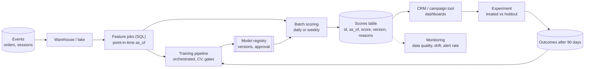

# Interview prep: churn project, system design and MLOps

## 1. Pitches
**60 seconds**
I built a churn-ranking system to help a retention team focus its limited outreach on customers most likely not to return. It uses a forward-looking 90-day label and features computed strictly before the cutoff, avoiding the leakage in my first label. After comparing four model families with nested cross-validation, I selected XGBoost and measured a held-out ROC-AUC of 0.818 (95% CI 0.791–0.843). I deployed it as a Streamlit app with customer-level SHAP explanations and built a retraining pipeline and drift checks around it. The main limitation is that this is a small, historical dataset from one retailer, with no live campaign outcomes to show that acting on the scores actually prevents churn.

Skeleton: "I built an end-to-end churn system on about 1.07 million retail transactions. The key design choice is a forward-looking label: features come from before a cutoff and churn means no order in the next 90 days, because my first label leaked. I compared four model families with nested cross-validation, wrote down my choice before touching the held-out set, and got a test ROC-AUC of 0.818 (95% CI 0.791–0.843). It runs as a Streamlit app with SHAP reasons, a retraining pipeline and drift monitoring. The main limit is that the historical data covers one retailer and has no campaign outcomes, so I cannot claim the model improves retention."

**Numbers I must know cold**
| Item | Value | Source |
|---|---|---|
| Raw transactions | 1,067,371 | `README.md` |
| Customers in the ML table | 5,283 (4,226 train, 1,057 held-out) | `scripts/readme_facts.py` |
| Churn rate (forward label, latest snapshot) | 56.6% | `scripts/readme_facts.py` |
| Final model and key hyperparameters | XGBoost: 150 trees, max_depth 2, learning_rate 0.03, min_child_weight 3; threshold 0.07 | `app_artifacts/model_manifest.json` |
| Test ROC-AUC (95% CI) | 0.818 (0.791 to 0.843) | `reports/model_comparison_report.md` |
| Top-10% precision and lift | 0.925 (95% CI 0.858 to 0.962); lift 1.634x | `README.md` |
| Nested CV AUC of the four families | Logistic Regression 0.796; Decision Tree 0.778; Random Forest 0.802; XGBoost 0.803 | `reports/nested_cv_day84.csv` |
| Automated tests | 99 tests collected | `scripts/readme_facts.py` |
| Live app | https://ecommerce-churn-project.streamlit.app/ | `docs/deployment.md` |

## 2. System design: churn prediction for 10 million customers

**Step 0: clarify before drawing**
1. Who acts on the output and how (email, discount, call centre)? How many customers per week can they contact?
2. What is churn here: an explicit cancellation, or silence for N days? Horizon 30, 60 or 90 days?
3. How often do decisions change: daily, weekly, or at an event such as a cancel-page visit?
4. Scale: customers, events per day, length of history.
5. Constraints: privacy rules, explainability for agents, budget, team size.

**Step 1: back-of-envelope (state these as assumptions)**
- Feature table: 10M customers x 30 numeric features x 8 bytes is about 2.4 GB. It fits on one machine.
- Raw events: 2 orders per customer per month is about 20M orders per month, about 60M line items per month, about 700M rows per year. The expensive part is computing features from raw events, not scoring.
- Scoring: a boosted-tree model with a few hundred shallow trees should score 10M rows in minutes on one multi-core machine (benchmark before claiming).
- Training: 10M x 30 fits in memory for histogram-based XGBoost. Spark would be for the raw-event aggregation, not the model.

**Step 2: architecture**

**Step 3: design decisions (say why, and what you would not build)**
1. **Point-in-time features.** Every feature is computed as of a date and uses only earlier events. The main value of a feature store is that training and serving use the same definitions. My project: `build_customer_dataset(as_of=...)` plus invariance and parity tests.
2. **Batch first.** Churn risk changes slowly, so daily or weekly batch scoring is enough. Real-time scoring only for trigger events, using the same feature code.
3. **Store scores with metadata:** customer id, as_of, score, model version, reason codes. Needed to join with outcomes later.
4. **Evaluation under label delay.** Truth arrives after the horizon (90 days). Evaluate by time: train on older snapshots, test on the newest. Log predictions at scoring time.
5. **Prediction is not impact.** A high-risk customer may be a lost cause, or would have stayed anyway. Measure the incremental effect with a randomized holdout (control group) or uplift modelling, and choose who to contact by expected incremental value under the budget.
6. **Rollout.** Champion/challenger, shadow scoring, canary on one segment, rollback to the previous version.
7. **Monitoring.** Data quality (nulls, ranges, freshness), feature drift (PSI), score drift and alert rate, delayed performance, pipeline health, and an alert policy that limits false alarms.
8. **Governance.** Minimise personal data, pseudonymous IDs, retention limits, deletion on request, fairness slices (for example by country), human review of automated offers. Involve legal for the rules (GDPR); this is not legal advice.
9. **Failure modes.** Late feed (silent all-churned labels), schema change, library mismatch, score shift, campaign fatigue.

**Step 4: tool decisions**
| Tool | Solves | I would add it when | Why not here |
|---|---|---|---|
| MLflow (used, local) | Experiment tracking, model registry | Several people or models: remote server and registry | One user, local SQLite store is enough |
| Airflow / Prefect | Scheduling, retries, dependencies, UI | Several scheduled jobs, SLAs, a team | One pipeline, manual trigger; `src/pipeline/mini_dag.py` shows the concepts |
| Docker | Same environment everywhere | Deploying beyond a managed platform | Community Cloud builds from pinned requirements; planned in the roadmap |
| Feature store | Consistent features for training and online serving | Two or more models share features, or online serving | One model, features from one tested function |
| Spark / warehouse SQL | Raw events too large for one machine | Hundreds of millions of raw events | 1M rows |
| Kubernetes | Scaling services | Many users or services | Batch scoring and a small app |
| Streaming (Kafka) | Features within seconds | Decisions needed in seconds | Churn changes slowly |
| CI (GitHub Actions) | Tests on every push | Now, as the next step | Tests run locally; `tests/test_repo_hygiene.py` is the gate |

**Step 5: where am I on MLOps maturity?**
Level 0 is manual. Level 1 is an automated training pipeline with data validation. Level 2 is CI/CD of the pipeline itself. This project sits between 0 and 1: a validated, cached pipeline with a human gate, but it is triggered manually, has no CI, no registry and no live labels.

## 3. Question bank
**Q: What is data leakage, and did you have it?**
- Define it; my first label used Recency over the whole period and Recency was also a feature, so a model could re-learn the rule.
- Fix: cutoff date, features before it, label after it.
- Proof: a test that changes future rows and checks that no feature changes.
- Evidence: `src/features/build_features.py`, `tests/test_build_features.py`

**Q: How did you pick the final model?**
- Cross-validation, then nested CV because the search score is optimistic; 1-SE rule for the simpler model.
- I wrote the choice into a committed file before scoring the held-out set, and say plainly when intervals overlap.
- Evidence: `reports/final_model_choice_day84.md`, `reports/nested_cv_day84.csv`

**Q: Why not accuracy?**
- Compare with the majority-class baseline; churn is about 57% here, so accuracy alone barely beats it.
- Use ROC-AUC for ranking, and precision@k and lift because the budget limits how many customers can be contacted.
- Evidence: `reports/model_comparison_report.md`

**Q: How did you choose the threshold?**
- Out-of-fold predictions and assumed costs, never the test set; the test set was scored once.
- Scores are class-weighted, so they are for ranking, not calibrated probabilities.
- Evidence: `reports/model_comparison_report.md`

**Q: Explain SHAP and its limits.**
- Each prediction is split into additive feature contributions; global importance is their average size.
- Limits: not causation, correlated features share credit (so I also looked at grouped importance), units are model units.
- Evidence: `reports/shap_importance_day85b.csv`, `src/models/explain.py`

**Q: How do you know the deployed app matches your evaluation?**
- A test checks that the app's scoring path reproduces the reported test AUC.
- The model file is checked by hash and library versions are compared before loading.
- After deployment I compared three customers' scores on the live app with local values.
- Evidence: `tests/test_lookup.py::test_app_scores_reproduce_card_auc`, `reports/live_check_day96.md`

**Q: How is the project reproducible?**
- Pinned requirements, a manifest with library versions and the model hash, one deterministic split function, `as_of` snapshots, and tests for each.
- Evidence: `app_artifacts/model_manifest.json`, `tests/test_deploy_ready.py`, `src/features/split.py`

**Q: How did you deploy, and how would you roll back?**
- Streamlit Community Cloud builds from GitHub, so a push is a deployment; I ran a 10-point live checklist.
- Rollback: revert the commit and push.
- Evidence: `docs/deployment.md`, `reports/live_check_day96.md`

**Q: How would you retrain?**
- Pipeline with an explicit `as_of`, a challenger trained from the pre-registered recipe, a sealed holdout, and a manual promotion gate.
- Labels arrive 90 days late, so the newest labelled snapshot is 90 days old, and the old random holdout cannot be reused.
- Evidence: `docs/retraining_design.md`, `src/pipeline/run_pipeline.py`

**Q: How do you monitor it?**
- Without labels: data checks, PSI per feature, score drift, alert rate. With labels (90 days later): realised precision@k.
- I calibrated the detector with an A/A split and a stress test, and excluded drift that exists by construction.
- Evidence: `docs/monitoring_plan.md`, `src/monitoring/drift.py`, `reports/drift_stress_day95.csv`

**Q: How do you test ML code?**
- Invariance tests for leakage, parity tests between training and serving, A/A tests for the drift detector, tests for caching and failure in the pipeline.
- Evidence: `tests/test_drift.py`, `tests/test_mini_dag.py`

**Q: What did you track in MLflow, and what did you refuse to track?**
- Only cross-validation metrics; a guard rejects test-style metric names.
- The guard is name-based, so it can be bypassed; the real record is the git history.
- Evidence: `src/tracking/mlflow_utils.py`, `tests/test_tracking.py`

**Q: Tell me about a mistake you made.**
- Situation and fix: the leakage story above (what you noticed, how you checked, what changed).
- Second mistake: I initially treated the best hyperparameter-search score as a fair estimate of generalization. Nested CV showed why that can be optimistic (for the tree, 0.785 in the search versus 0.778 nested AUC), so I now report the nested estimate and keep the held-out set for the final evaluation.

**Q: How did you handle ambiguity about what churn means?**
- I defined it, checked how the churn rate changes with the threshold, and wrote the definition and its limits in the README.
- Evidence: `README.md`

**Q: What would you do differently?**
I would measure incremental retention with a randomized campaign holdout before claiming the model creates business value. I would also add CI and deployment smoke tests, then evaluate on several time-based snapshots rather than relying on one historical split. Finally, I would calibrate scores if the business needs probabilities as risk estimates; currently, class weighting means I use them for ranking only.

## 4. Scenario drills (first three checks, 60 seconds each)
1. **The score distribution shifted two weeks after deployment.** Check upstream data (schema, nulls, freshness), then which features drifted (and which drift by construction), then the alert rate.
2. **Marketing says 40% of flagged customers would have stayed anyway.** Separate prediction from impact; read precision@k against the base rate; propose a control group.
3. **An upstream team renamed or removed a column.** Data contracts that fail fast, a schema check, and downstream steps that skip instead of using stale output.
4. **You need scoring in under 100 ms.** Precompute features in an online store, keep the model small, watch p99 latency, reuse the same feature code, and have a fallback.
5. **Prove that the campaign works.** Randomized holdout, one outcome metric, sample size, guardrail metrics.
6. **The model is worse for one country.** Slice the metrics, check the sample size, check calibration per slice, decide on a fairness policy.
7. **The customer base grows to 1 billion.** The first thing to break is feature computation and storage, not the model; use incremental, date-partitioned feature jobs.
8. **You retrain monthly but labels arrive 90 days late.** Snapshots, time-based holdout, a challenger on the newest labelled window, and accept the delay.

## 5. Questions to ask the interviewer
- How is churn defined and acted on here, and has the impact been measured with a control group?
- How long do labels take, and how do you evaluate models in the meantime?
- What does the path from a notebook to production look like, and who approves a model?
- How is monitoring set up, and who gets paged?
- What would success look like in the first 90 days?